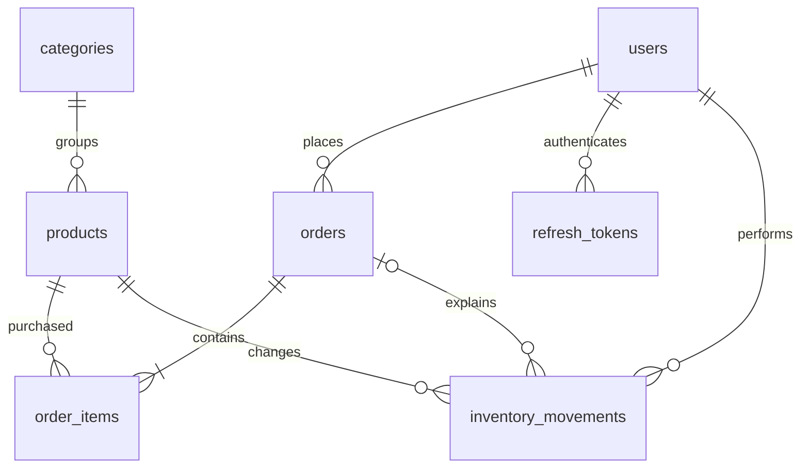

# Order Management API

A production-minded portfolio backend that focuses on correct stock accounting, visible SQL, and testable business rules. Built with JavaScript ES modules, Node.js, Express 5, PostgreSQL 17, node-postgres, Zod, bcrypt, JWT, Pino, Jest and Supertest. No ORM.

Customers browse a catalog and place or cancel their own orders. Admins maintain categories, products and inventory, advance orders, and inspect SQL sales reports. Money is in cents, in a single implicit currency (USD); there is no payment processor.

## Architecture

```text
src/routes.js            routing, validation and access control
src/controllers/        HTTP responses and refresh cookies
src/services/           business rules, transactions, authentication
src/repositories/       parameterized SQL and read models
src/middleware/         authentication and role checks
src/validation.js       strict Zod request contracts
src/db.js               connection pool and transaction boundary
src/app.js              middleware, logging and central error handler
src/server.js           readiness check and graceful shutdown
```

Catalog operations that consist of one SQL statement go directly from controllers to repositories. Multi-statement inventory and order workflows go through services. The small structure intentionally avoids a generic base repository or dependency injection framework.

## Database



Seven application tables plus `schema_migrations`. UUID primary keys, foreign keys, unique keys and checks are in [001_schema.sql](db/migrations/001_schema.sql). Product/category deletion is deactivation; foreign keys retain historical orders. Products start with zero stock and every API stock change creates an inventory movement. Order line name and price snapshots intentionally preserve purchase-time facts. Order history is a bounded JSON array (at most four transitions) instead of an eighth table. See [SQL design and reports](docs/SQL.md) for normalization and indexes.

## Run locally

Requires Node >=22.13 (CI uses Node 22), npm, and PostgreSQL 17. These instructions are for other developers; cloud implementation and verification are recorded in [verification](docs/VERIFICATION.md).

1. Copy `.env.example` to `.env`. Set `DATABASE_URL` to your PostgreSQL database, generate a strong `JWT_SECRET`, and set `SEED_PASSWORD` if using the optional seed. Never commit `.env`.
2. `npm ci`
3. `npm run migrate`
4. Optional: `npm run seed` (development only).
5. `npm run dev` or `npm start`.
6. `GET /health` returns `{"status":"ok"}` after a database round trip.

The development seed creates `admin@example.com`, `maya@example.com`, and `omar@example.com`, all using **your** `SEED_PASSWORD`; it also creates three categories, five products, initial stock movements and four example orders. Re-running skips if users already exist. Do not seed production. The seed's base fixture is transactional; sample order creation follows through normal services. An interruption there can leave an incomplete example dataset, so use a fresh development database to regenerate it.

Migrations run in filename order, record completion, and hold an advisory transaction lock. This initial migration is forward-only; rollback means restoring a backup or rebuilding a disposable development database. Never edit an already-applied migration; add a new file.

### Docker Compose

Copy `.env.example` to `.env`, replace `JWT_SECRET` with a random value and select a URL-safe `POSTGRES_PASSWORD`. `DATABASE_URL` is for host-side commands; Compose sets its own database hostname to `db`.

```sh
docker compose up --build -d
# Wait for db health, one-shot migration completion, then API health.
docker compose ps -a
docker compose logs api
# Optional development seed, after setting SEED_PASSWORD in your local .env:
docker compose run --rm -e SEED_PASSWORD api npm run seed
docker compose down
```

Compose defaults to development for HTTP testing. For production set `NODE_ENV=production`, use TLS at your reverse proxy, and use a strong database password, restricted network, backups and a least-privileged application database role. Production refresh cookies are `Secure` and require HTTPS. Do not expose PostgreSQL publicly; the example publishes it on loopback only. Persistent data survives `down`; `down -v` is destructive. The image runs as the `node` user and has a functional health check. Configure proxy trust in `src/app.js` for your actual trusted deployment hops before relying on client IP rate limiting behind a reverse proxy.

### Environment variables

| Variable            | Purpose                                                                   |
| ------------------- | ------------------------------------------------------------------------- |
| `DATABASE_URL`      | Required PostgreSQL connection URL; use verified TLS for hosted databases |
| `JWT_SECRET`        | Required, >=32 characters; use cryptographically random material          |
| `NODE_ENV`          | development, test or production; default development                      |
| `PORT`              | 1–65535; default 3000                                                     |
| `CORS_ORIGINS`      | Comma-separated exact browser origins; default http://localhost:3000      |
| `LOG_LEVEL`         | Pino level; default info                                                  |
| `POSTGRES_PASSWORD` | Compose PostgreSQL credential; URL-safe characters in this example        |
| `SEED_PASSWORD`     | Development seed only; 12–72 UTF-8 bytes                                  |

## API reference

All API routes start with `/api`. Use `Authorization: Bearer <accessToken>` for protected routes. Strict schemas reject unknown request fields. UUIDs are required for IDs. Update routes use full-resource `PUT`, not partial `PATCH`, except order status. All timestamps are ISO 8601 instants with timezone. Date ranges are **from inclusive, to exclusive**, based on order creation time.

| Method       | Path                             | Access            | Purpose                                                      |
| ------------ | -------------------------------- | ----------------- | ------------------------------------------------------------ |
| POST         | `/auth/register`                 | Public, limited   | name, email, password; always customer                       |
| POST         | `/auth/login`                    | Public, limited   | email, password → access JWT and HttpOnly refresh cookie     |
| POST         | `/auth/refresh`                  | Cookie, limited   | Rotate refresh token                                         |
| POST         | `/auth/logout`                   | Cookie, limited   | Revoke refresh family, clear cookie                          |
| GET          | `/auth/me`                       | Signed in         | Current public user                                          |
| GET          | `/categories`, `/categories/:id` | Public            | Active list; individual category also exposes active flag    |
| POST         | `/categories`                    | Admin             | name, optional active                                        |
| PUT / DELETE | `/categories/:id`                | Admin             | Full update / deactivate                                     |
| GET          | `/products`                      | Public            | Search, filter, paginate and sort active catalog             |
| GET          | `/products/:id`                  | Public            | Active product with category JOIN                            |
| POST         | `/products`                      | Admin             | category_id, name, description, price_cents, optional active |
| PUT / DELETE | `/products/:id`                  | Admin             | Full update / deactivate                                     |
| POST         | `/products/:id/inventory`        | Admin             | Signed nonzero integer quantity adjustment                   |
| POST         | `/orders`                        | Signed in         | items: product_id, quantity (1–100)                          |
| GET          | `/orders`                        | Owner / admin     | Paginated order list; admins see all                         |
| GET          | `/orders/:id`                    | Owner / admin     | Order with price/name snapshots                              |
| GET          | `/orders/:id/history`            | Owner / admin     | Status, timestamp, actor audit entries                       |
| POST         | `/orders/:id/cancel`             | Owner / admin     | Cancel pending or confirmed order                            |
| PATCH        | `/orders/:id/status`             | Admin             | status; enforce allowed transition                           |
| GET          | `/reports/revenue`               | Admin             | Delivered revenue and order count                            |
| GET          | `/reports/top-products`          | Admin             | Delivered units, revenue and dense rank                      |
| GET          | `/reports/order-counts`          | Admin             | Counts grouped by status                                     |
| GET          | `/reports/monthly-sales`         | Admin             | UTC months and prior active month's difference               |
| GET          | `/reports/low-stock`             | Admin             | Active products at/below threshold                           |
| GET          | `/reports/customer-history`      | Admin             | Customers including zero-purchase customers, totals          |
| GET          | `/reports/customers/:id/orders`  | Admin             | Paginated purchase history                                   |
| GET          | `/health`                        | Public, no prefix | Database readiness; 503 on failure                           |

Catalog queries: `q`, `category_id`, `available=true|false`, `sort=name|price_cents|created_at`, `direction=asc|desc`, `page`, `limit`. Defaults: page 1, limit 20, created_at descending. Orders: `status`, `from`, `to`, `page`, `limit`. Reporting: `from`, `to`, `limit` (default 10), `threshold` (default 10, low-stock only). Low-stock is a current snapshot; dates do not affect it. Customer order history accepts the same status, date and pagination filters as order lists. Maximum limit is 100. Search treats `%` and `_` as SQL wildcard characters; values remain parameterized.

Import [openapi.json](docs/openapi.json) into Postman or Swagger Editor for exploration, including request schemas and authentication. Errors use `{ "error": { "code", "message", "requestId", "details"? } }`. Typical statuses: 201 creation, 200 read/update, 204 logout, 400 validation, 401 authentication, 403 forbidden, 404 missing/other owner's order, 409 stock/state/uniqueness conflict, 429 auth rate limit, 500 unexpected failure. Never return internal SQL errors or password hashes. Every response has `X-Request-ID`; structured logs redact auth and cookie headers and never log request bodies.

### Example authentication and order

```http
POST /api/auth/login
Content-Type: application/json

{"email":"maya@example.com","password":"your-development-seed-password"}
```

```json
{
  "user": {
    "id": "<uuid>",
    "name": "Maya Hassan",
    "email": "maya@example.com",
    "role": "customer"
  },
  "accessToken": "<jwt>",
  "tokenType": "Bearer",
  "expiresIn": 900
}
```

Retain the `Set-Cookie` value in the API client's cookie jar. Send it to `POST /api/auth/refresh` to obtain a fresh access token and rotated cookie. Refresh tokens are never in response JSON.

```http
POST /api/orders
Authorization: Bearer <jwt>
Content-Type: application/json

{"items":[{"product_id":"<uuid-from-product-list>","quantity":2}]}
```

```json
{
  "id": "<order-uuid>",
  "user_id": "<customer-uuid>",
  "status": "PENDING",
  "total_cents": "5000",
  "history": [{ "status": "PENDING", "at": "2026-11-06T12:00:00Z", "actor_id": "<customer-uuid>" }],
  "created_at": "2026-11-06T12:00:00Z",
  "updated_at": "2026-11-06T12:00:00Z",
  "items": [
    {
      "product_id": "<uuid>",
      "product_name": "Wireless Mouse",
      "quantity": 2,
      "unit_price_cents": 2500
    }
  ]
}
```

`bigint` money totals and report aggregates are decimal **strings**, preserving PostgreSQL precision; per-product integer prices are JSON numbers. Paginated catalog/order responses use `{data,total,page,limit}`. Reports return arrays.

## Authentication design

bcrypt cost 12; passwords are 12–72 UTF-8 bytes to avoid bcrypt truncation. Emails normalize to lowercase. Registration cannot set a role. Seed creates the development admin; real admin provisioning must be an operator-controlled workflow, never public registration.

Access JWTs expire in 15 minutes and validate algorithm, issuer, audience and signature. Roles come from the current database user, not stale JWT claims. Refresh tokens are 48 random bytes, stored only as SHA-256 hashes, and expire after seven days; rotation extends that window. Cookies are HttpOnly, SameSite=Strict and Secure in production. Authentication routes reject supplied browser origins outside the configured list. Access JWTs should stay in client memory; same-origin browsers should use credentials for cookies. No token in URLs or logs.

A transaction locks each refresh token during rotation. Reusing a revoked token revokes the entire family **and commits that revocation before returning 401**. Clients must serialize refresh requests; concurrent refresh or retrying a consumed token intentionally invalidates the family. Logout revokes the family; existing access JWTs remain valid for at most 15 minutes. Add a denylist if immediate JWT revocation becomes a requirement. Schedule deletion of expired refresh rows according to a retention policy; replay detection needs revoked rows retained through their relevant lifetime. This sample uses a per-process auth limiter (100 requests/15 min/IP); use shared storage for multiple API instances.

## Transactions and order lifecycle

```text
PENDING   → CONFIRMED or CANCELLED
CONFIRMED → SHIPPED or CANCELLED
SHIPPED   → DELIVERED
DELIVERED → terminal
CANCELLED → terminal
```

Order creation validates at most 100 distinct product lines, locks product rows in ascending UUID order, checks active product/category and available stock, computes cents on the server, creates order/items, deducts stock, records movements and commits. Every statement uses the same checked-out connection. Any failure rolls back every write. No client price, total or duplicate line is accepted. `READ COMMITTED` plus row-level locks is enough for these stock invariants; a competing buyer waits, then observes updated stock.

Cancellation locks the order first, checks owner and state, then locks all products in ascending UUID order, restores stock and appends status history in the same transaction. Repeated/concurrent cancellation returns 409 after the first succeeds; a uniqueness constraint also prevents duplicate restoration movements. Stock adjustments lock products and record audit movements transactionally. There is a maximum stock of 1,000,000; if restocking leaves insufficient capacity to restore cancelled items, cancellation fails atomically and an admin must first adjust stock.

Product price/deactivation updates also acquire PostgreSQL row locks through UPDATE. Category activation is checked at order creation's statement snapshot; a concurrent category deactivation may complete while an already-started purchase proceeds. This is an intentional catalog-visibility policy, not an inventory reservation. No network calls happen inside stock transactions. Deadlocks are reduced by lock order; lock/statement timeouts still produce retryable server errors. Order POST has no idempotency key: clients must not blindly retry after an uncertain network result.

## SQL reports and query plans

Examples: `/api/reports/revenue?from=2026-01-01T00:00:00Z&to=2027-01-01T00:00:00Z`, `/api/reports/top-products?limit=5`, `/api/reports/low-stock?threshold=10`.

Only delivered orders contribute revenue and sales units. Revenue is attributed to order **creation** date, not delivery date. Monthly comparisons use the previous month with sales, not necessarily the previous calendar month; missing months are not zero-filled. Reports exclude taxes, shipping, refunds and payment settlement. `npm run explain` executes real `EXPLAIN (ANALYZE, BUFFERS)` read queries. See [SQL.md](docs/SQL.md) and the recorded [plans](docs/EXPLAIN.txt); a tiny seed dataset cannot establish production throughput or justify removing indexes.

## Tests and CI

Use a **separate disposable** database with a name ending in `_test`; the suite truncates application tables. Never use your development or production database. Supply `DATABASE_URL` and `JWT_SECRET` for this database, then:

```sh
npm ci
npm run migrate
npm run lint
npm run test:coverage
npm run format:check
```

`npm test` sets NODE_ENV=test and runs serially for repeatable resets. Tests use real PostgreSQL, no SQL mocks: auth, role restrictions, ownership, catalog, validation, price snapshots, last-unit overselling, reversed locks, audit inserts, stock adjustment, injected mid-transaction failure, cancellation races, lifecycle, reports and rate limiting. Fixtures hash one test password and create isolated users/products before every test; most feature tests sign test access JWTs, while the dedicated auth tests use real login/rotation/logout.

GitHub Actions provisions PostgreSQL 17, installs the exact lockfile, migrates, lints and runs tests with coverage. Failure in any required step fails the job. See [verification](docs/VERIFICATION.md) for commands actually executed and CI access limitations.

## Scope and future improvements

This is production-minded, not production-certified. Add real payments/refunds, fulfillment addresses, multi-currency, idempotency keys, email verification/reset, explicit admin provisioning, a shared rate-limit store, expiry cleanup, managed secrets, deployment automation, observability and backups before public operation. Offset pagination can drift during writes; use keyset pagination for large datasets. Count/page queries are separate snapshots. Substring ILIKE is fine for this small catalog; use pg_trgm/full-text search with measured demand. Database schema prevents invalid row values, while application transactions enforce cross-row totals and lifecycle rules; direct operator SQL can bypass those service invariants. Do not grant application users direct database access.

See [LEARNING_GUIDE.md](LEARNING_GUIDE.md) for interview explanations and tradeoffs.
